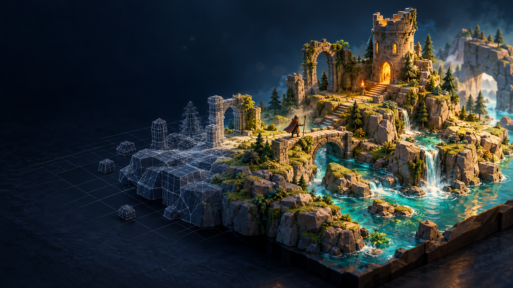

# GameCraft Skills

**把开发视频中的实践，变成有来源、能执行、可验收的 AI 游戏制作工作流。**



适合希望持续做多款游戏的个人开发者。重点覆盖 3D 原型、资产与角色动画、实际试玩、信息检索和介绍视频；沿用你的引擎与作品方向。

[观看 2 分钟介绍片](https://github.com/wusar/gamecraft-skills/releases/download/v0.1.0/gamecraft-intro.mp4) · [最新发布](https://github.com/wusar/gamecraft-skills/releases) · [来源与经验卡](research/sources.json) · [验证范围](docs/validation.md)

## 有什么

| Skill | 解决的问题 |
|---|---|
| [`gamecraft`](skills/gamecraft/SKILL.md) | 从现有工程/模板，到角色测试场、小步玩法实现和可运行交付 |
| [`gamecraft-research`](skills/gamecraft-research/SKILL.md) | 从视频、官方文档与原仓库提炼经验；可选 DeepSeek Search/Fetch 和本地缓存 |
| [`gamecraft-video`](skills/gamecraft-video/SKILL.md) | 实机录制、AI 辅助动效、模型生成镜头的分镜、声音、字幕与渲染 |

它们是可移植的 `SKILL.md` 文件，供支持 Agent Skills 的编码助手按需读取。没有捆绑引擎、云服务账户或模型。

## 安装与使用

Python 3.10+。克隆后预览复制计划，再安装到 Codex 技能目录：

```sh
git clone https://github.com/wusar/gamecraft-skills.git
cd gamecraft-skills
python scripts/install.py
python scripts/install.py --apply
```

已有同名技能时脚本停止，先比较版本。其他宿主可把 `skills/` 中各个文件夹复制到其技能目录；新会话中使用。Windows 字体和语音只用于介绍片制作，不是技能运行依赖。

示例请求：

> 用 $gamecraft 在现有 Godot 工程里做一局可重来的 3D 探索小样。先查已有模板，角色先进测试场，再实际试玩验收。

> 用 $gamecraft-research 分析几条游戏开发复盘。保留原作者、时间点、适用条件和失败案例，再更新工程流程。

> 用 $gamecraft-video 为当前项目做一段中文介绍，明确区分概念画面与实际玩法。

## DeepSeek 信息搜索

提供标准库实现的独立 Search/Fetch 客户端。Key 从环境变量读取；不会读取浏览器 Cookie 或把 Key 写入缓存。

```sh
python skills/gamecraft-research/scripts/research.py search 'Godot testing site:github.com' --count 5 --dry-run
# 在自己的环境设置 DEEPSEEK_API_KEY 后运行：
python skills/gamecraft-research/scripts/research.py search 'Godot testing site:github.com' --count 5
python skills/gamecraft-research/scripts/research.py fetch 'https://docs.godotengine.org/en/stable/'
```

查询结果缓存到当前工作目录 `.cache/gamecraft-research`；`--refresh` 才明确要求重新联网。费用按服务当前规则计算，缓存和模型 Token 分开记录。搜索返回内容是线索，取得正文后还需核验。更多见[接入说明](skills/gamecraft-research/references/deepseek.md)。

## 从什么资料得来

当前累计分析 **14 条公开视频、约 229 分钟音轨、168 张抽帧**，整理 25 项来源与 10 张经验卡，并交叉阅读官方文档和原仓库。包含转载、同系列、二手评论及一条 30 秒预告；来源数量不代表独立验证次数，也不根据预告推断质量。最新增量见[爬取记录](docs/crawl-2026-10-29.md)，现成方案见[相关项目](docs/related-work.md)。

重点经验包括：从匹配的模板起步、统一角色规格、建立动作测试场、明确位移责任、运行/截图/日志反馈、保存计划与有效场景，以及多视角检查、交互后控制回归和资产修整成本。每条经验附来源和适用条件。

这是一套研究驱动的初版工作流，**尚未用它完成并发布一款新游戏**。脚本/API 检查、模型情景评估和游戏端到端验证分别记录，避免用“文档检查通过”替代“游戏能玩”。

## 介绍视频与贡献

v0.1.0 介绍片对应首版 11 条视频、约 179 分钟的研究快照。它用原创 ImageGen 概念图、Canvas 动效、中文系统合成旁白与字幕制作，不含第三方视频镜像，也不代表游戏实机。分镜和重建脚本见 [`media/`](media/README.md)。

代码和原创技能文档按 MIT 开源，图片与第三方来源分别见 [ATTRIBUTION](ATTRIBUTION.md)。欢迎按[贡献说明](CONTRIBUTING.md)补充真实开发与发布后的经验。

```sh
python -m unittest discover -s tests -v
python scripts/validate.py
```
